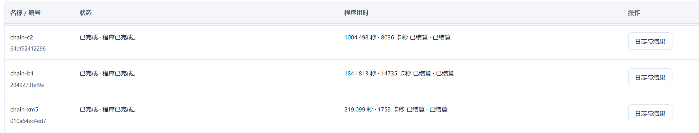
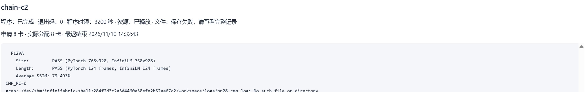

# MiniMax-H3 FL2VA 在 InfiniLM / InfiniCore + 九齿（NineToothed）上的适配与优化

嵩山杯（2026 秋季高级人工智能）初赛作品代码仓库，队伍 **zzucs123**。

本仓库只包含**自研代码、补丁、作业脚本与实测结果**；上游 InfiniLM / InfiniCore / nine-toothed
以补丁形式给出，不复制其完整源码（体积与许可原因，见 `THIRD_PARTY_NOTICES.md`）。

## 一句话结果

在非 legacy 路径（InfiniLM 引擎 + InfiniCore 算子 + 九齿 AOT kernel）上，用 **8 卡 TP=8** 跑通
MiniMax-H3 **FL2VA**：768×928、124 帧、**50 步**、带音频，8 卡出片 **909 s**（单步 18.18 s，作业共 1004 s）。
官方评测脚本 `examples/minimax_h3_compare.py` 输出：

```
[result] MiniMax-H3 video comparison
  FL2VA
    Size:         PASS (PyTorch 768x928, InfiniLM 768x928)
    Length:       PASS (PyTorch 124 frames, InfiniLM 124 frames)
    Average SSIM: 79.493%
CMP_RC=0
```

这一份结果出自仓库当前代码的**从源码重建**：现场编出五个 `.so`，再用它们跑同一份配置出片并评测
（见下文「重建链实测」表）；出片前的启动脚本固定 `HIP_LAUNCH_BLOCKING=1`（见下）。

成片本身（`output2/nl50_1110_053831.mp4`，1,615,256 B）
本地 ffprobe 复核为 h264 768×928 / 124 帧 / 24 fps / 含 aac 音轨，与 compare 的 `Size` / `Length` PASS 一致；
该文件较大未入库，如需可与平台作业 `64df924122964eacbd7787e2a4c76369` 的记录核对。

## 结果截图

从源码重建后跑 50 步出片，官方 `examples/minimax_h3_compare.py` 输出 `Average SSIM: 79.493%`、`CMP_RC=0`。
三个作业（xmake 工具链 → 编五个 .so → 出片+评测）的列表：



最后一个作业的作业卡片与日志框（`Size` / `Length` PASS、`Average SSIM: 79.493%`、`CMP_RC=0`）：



成片抽帧（768×928 / 124 帧 / 24 fps / 含音轨）：


## 核心贡献

1. **九齿编译链移植**到海光 DCU（gfx936）：处理 10 类平台适配差异，官方算子测试全部通过
   （swiglu 126/126、rms_norm 108/108、timestep_embedding 18/18、mrope 36/36）。
2. **九齿 fused attention 接入**：在 InfiniCore 里新增 HYGON 后端（`src/mha_ninetoothed_hygon.cc`），
   head-major strided 视图直接喂 kernel，QK 缩放折进 fp32 在线 softmax，三轴 RoPE 前置，
   head_dim=80 零填充到 128；因果注意力只出现在条件编码器，走 InfiniCore 自有 causal_softmax，不经过 op::mha。
3. **多设备 kernel 缓存键**：九齿 AOT 生成物为每个 kernel 变体维护一张静态表缓存已加载模块。
   HIP 的模块是 per-context 的，键必须显式携带设备维度，否则全进程只建一份模块、非首卡拿到别的
   设备上下文里的句柄。两种等价形式：
   - 源码级：`src/kb7.py`（把键换成 `hipGetDevice()+1`，幂等，随后重编 InfiniCore）；
   - 交付用：`src/pre_ctxid.c`——`LD_PRELOAD` 运行时 shim，把 `hipCtxGetId` 的返回值按设备混键，
     **不改一行模型代码、不参与任何模型数值计算**。

   三层验证：算子级（8 设备均 max_vs_torch=0.00129563，与设备执行顺序无关）、
   TP2 截断模型（video cos=0.999988、audio cos=0.999975）、
   真实 S=27570 单次前向 TP8 vs TP1（video cos=0.999985、audio cos=0.999963）。
4. **多卡执行次序确定**：8 个 rank 各有一条独立线程与一张设备，纯异步下发时 rank 间的读写次序
   取决于调度时序，同一份输入的重复执行会有低位差异——单次前向看不出来（bf16 噪声量级），
   在 50 步去噪里会被放大成不同轨迹。出片脚本固定 `HIP_LAUNCH_BLOCKING=1`；50 步实测 18.18 s/step，
   耗时由每步的通信与访存主导，同步开关对总时长几乎无影响。
5. **算子性能**：swiglu 1.56–1.67×、rms_norm 宽行 1.14–1.25×（相对参考实现），
   端到端 18.18 s/step（50 步 909 s）。

## 目录

```
src/      pre_ctxid.c（设备键 shim）、kb7.py（源码级实现）、mha_ninetoothed_hygon.cc（HYGON FA 后端）、
          infinicore_ninetoothed_hygon.patch（为 HYGON 打开九齿的整套上游补丁）
jobs/     setup.py（集群侧解包/装配）、run_tp8_fl2va_cmpgen.sh（TP8 出片交由官方 compare 生成 + 分段时长表）、
          run_tp8_fl2va.sh（同一流程的另一写法：自己出片、compare 复用成片，无时长表）、
          ab_native_vs_legacy.sh（同 seed 2 步 A/B）、
          fa_precision_probe.py（FA 相对 torch SDPA 的精度随 S 变化）、ssim_report.py（同口径 SSIM 汇总）、
          repro_xmake_step.sh（从源码自举 xmake 工具链，可反复续跑）、
          repro_build.sh（校验 sha256 → 从三份源码重建五个 .so）、repro_run.sh（50 步出片 + 官方 compare）
build/    bld_infinicore.sh（InfiniCore 构建配方）、rebuild_and_repack.sh（改 kernel 后重生成 + 重打包）、
          from_scratch.sh（只喂三份源码输入的六步构建）、reproduce.sh（一条命令跑通 from_scratch 并校验产物）、
          xmake_build.sh（xmake 源码编译封装）
input/    reference_fl2va.mp4（官方 compare 的参考片，768×928 / 124 帧 / 24 fps / 1.5 MB，
          由本项目 legacy PyTorch 路径产出）、1280X1280.JPEG（出片首帧，146,182 B）；说明见 input/README.md
results/  chain_20261110_xmake.txt / _build.txt / _run.txt（从源码重建的三段链完整作业日志，末段含官方
          compare 原始输出 79.493%）、ab_2step_table.md（2 步 A/B 实测）
docs/     从零复现指令流程.md（逐条复现指令）
figures/  compare_chain_jobs.png / compare_chain_log.png（重建链三个作业的列表与日志，官方 compare 79.493%）、
          video_frames_nl50.png（成片第 1/61/124 帧抽帧对照）
```

## 复现流程

本仓库的结果全部来自**从源码重建**：现场编出五个 `.so`，再用它们跑 50 步出片，并由官方 `examples/minimax_h3_compare.py` 评测。
下面是完整流程的摘要；**逐条命令、期望输出与坑清单见 [`docs/从零复现指令流程.md`](docs/从零复现指令流程.md)**，两份内容一致，文档更细。

流程六步：第 0 步前置检查 → 第 0.5 步资产上传 → 第 1 步取码校验 → 第 2–4 步三段作业（工具链 / 构建 / 出片评测）→ 第 5 步提交 → 第 6 步判读。

### 第 0 步 前置检查

- **平台**：海光 DCU（gfx936）批作业；DTK 26.04 装在 `/opt/dtk`；Python 3.11（cp311）；PyTorch 2.9.0+das.opt1.dtk2604。
- **模型权重**：平台公共路径 `/public/home/aclsylqidf/shared/MiniMax-H3/diffusers`（不随仓库分发）。先确认四样都在：

  ```bash
  SH=/public/home/aclsylqidf/shared/MiniMax-H3/diffusers
  ls $SH/model_index.json $SH/transformer $SH/vae $SH/audio_vae   # 四条都要存在
  ```

- **FA 依赖**：非 legacy 路径的 VAE / 音频 VAE / 文本编码走 torch 的 SDPA 适配器，需要厂商 flash-attention 的 `.so`。
  从 Release `vendor-fa-dtk2604` 取 `fa_dtk2604_torch290_cp311.whl`（658,898,543 B，sha256 `8546e46b…`，内含
  `flash_attn_2_cuda…so` 2,088,777,840 B），`jobs/setup.py` 解包后把路径写进 `$W/fa_so_path.txt`，出片脚本据此 `export FA_SO_PATH`。
  缺它时导出的是**空串**，最可能报 `Not load library for Cutlass Fa so`——按「必需、未验证可省」理解。

### 第 0.5 步 资产下载到本机 → 上传到 `$HOME`

Release `assets-v1`：<https://github.com/Wang-Yi-Dao/minimax-h3-fl2va-infini-ninetoothed/releases/tag/assets-v1>

| 资产 | 大小 | 放到 `$HOME` 下 | 用途 |
|---|---|---|---|
| `SHA256SUMS` | 4,413 B | — | 校验清单 |
| `wheels.tgz` | 88,134,582 B | `minimax_h3/wheels.tgz` | 27 个 `.whl`（transformers 5.14.1 等） |
| `InfiniLM-src.tgz` | 10,441,980 B | `src/InfiniLM.tgz` | 引擎源码树（`jobs/setup.py` 解包） |
| `prebuilt-libs.tgz` | 13,126,650 B | `minimax_h3/prebuilt-libs.tgz` | 五个 `.so` + `xmake-toolchain.tgz`（Plan B / 跳过工具链） |
| `artifacts-prebuilt.tgz` | 99,251,173 B | `minimax_h3/artifacts-prebuilt.tgz` | 运行期打包，解出 `artifacts/{infinicore,infinilm}.tgz` |
| `vendor-fa-dtk2604/fa_dtk2604_torch290_cp311.whl` | 658,898,543 B | `minimax_h3/wheels5/…whl` | 厂商 FA（见第 0 步） |

> **Release 资产先在本机下载，不要在集群节点上 curl。**
> 2026-11-13 在批作业里实测：`github.com`（含 Release 直链）、`codeload.github.com` 一律返回 `000`，
> 集群出口只有镜像（`gh-proxy.com`、`ghproxy.net`）与 PyPI（`pypi.org`、`pypi.sourcefind.cn`）通。
> 正确姿势：本机下载 → 平台「个人存储」上传到 `$HOME/minimax_h3/…` → 作业里再用。仓库代码本身可以在作业里取（走镜像）。

```bash
mkdir -p assets && cd assets
BASE=https://github.com/Wang-Yi-Dao/minimax-h3-fl2va-infini-ninetoothed/releases/download
curl -fL -o SHA256SUMS             "$BASE/assets-v1/SHA256SUMS"
curl -fL -o wheels.tgz             "$BASE/assets-v1/wheels.tgz"
curl -fL -o InfiniLM-src.tgz       "$BASE/assets-v1/InfiniLM-src.tgz"
curl -fL -o prebuilt-libs.tgz      "$BASE/assets-v1/prebuilt-libs.tgz"
curl -fL -o artifacts-prebuilt.tgz "$BASE/assets-v1/artifacts-prebuilt.tgz"
curl -fL -o fa_dtk2604_torch290_cp311.whl "$BASE/vendor-fa-dtk2604/fa_dtk2604_torch290_cp311.whl"
sha256sum -c SHA256SUMS --ignore-missing
```

上传后在平台的开发终端 / notebook 里解包（**不需要算力卡**）：

```bash
# 1) wheels：27 个 .whl
mkdir -p $HOME/minimax_h3/wheels && tar xzf $HOME/minimax_h3/wheels.tgz -C $HOME/minimax_h3
ls $HOME/minimax_h3/wheels/*.whl | wc -l          # 期望 27

# 2) artifacts：必须是 $HOME/minimax_h3/artifacts/{infinicore,infinilm}.tgz
#    jobs/setup.py 的 restore_tars() 打开这两个文件，缺了作业 C 会 STEP_FAIL 退出 21
cd $HOME/minimax_h3 && tar xzf artifacts-prebuilt.tgz && ls -l artifacts/

# 3) Plan B 才需要：五个 .so
cd $HOME/minimax_h3 && tar xzf prebuilt-libs.tgz && ls -l prebuilt/libs/ | head
```

**关键件**：`transformers-5.14.1-py3-none-any.whl`（镜像自带 5.0.0 会被 `setup.py` 跳过）、`diffusers-0.41.0`、`tokenizers-0.22.1`、`safetensors-0.8.0`。

### 第 1 步 取代码 + 校验源码输入

```bash
cd $HOME && git clone https://github.com/Wang-Yi-Dao/minimax-h3-fl2va-infini-ninetoothed.git repo && cd repo
cd src && sha256sum -c SHA256SUMS && cd ..
```

| 源码输入 | 内容 | 大小 / sha256 前缀 |
|---|---|---|
| `src/InfiniCore-snapshot-mit.tar.gz` | 上游 InfiniCore 快照（MIT，含 LICENSE） | 3,759,864 B / `620d40e2` |
| `src/overlay.tar.gz` | 改动过的 9 个源文件，根为 `ic/` | 19,254 B / `f1f28f73` |
| `src/kernels_deployed.tgz` | 出片所用库的九齿 kernel 源码 `ic/build/ninetoothed/`（106 文件） | 2,457,374 B / `fbf98247` |
| `src/infinicore_ninetoothed_hygon.patch` | 为 HYGON 打开九齿的上游补丁 | 52,648 B |

节点直连 GitHub 常失败，镜像可自选（也可本机下载 tar 包后上传）：

```bash
REL=https://github.com/Wang-Yi-Dao/minimax-h3-fl2va-infini-ninetoothed/archive/refs/heads/main.tar.gz
MIRROR=${MIRROR:-https://gh-proxy.com/}      # 留空即直连
curl -fL --http1.1 --retry 3 --retry-delay 3 -m 600 -o repo.tgz "$MIRROR$REL" \
  || curl -fL --http1.1 --retry 3 --retry-delay 3 -m 600 -o repo.tgz "https://ghproxy.net/$REL"
tar xzf repo.tgz
```

2026-11-13 节点实测（仅供选型）：直连 `github.com`、`codeload.github.com` = `000`；`gh-proxy.com` 5 s 成功；`ghproxy.net` 偶发 `curl: (92) HTTP/2 stream not closed cleanly`。

### 第 2 步 作业 A：编工具链

**工作目录需先选定**：`reproduce.sh` 的第一个参数是工作目录，源码、xmake 源码树、pybind11、九齿 AOT 中间文件、构建产物全放它下面。
要能写、建议 ≥10 GB，同一条链上沿用同一路径：

```bash
W=$HOME/mmh3_build                       # 持久盘（作业结束还在，可续跑）
W=${TMPDIR:-/tmp}/mmh3_build             # 节点内存盘（更快，作业结束即消失）
W=/path/to/writable/dir/mmh3_build       # 自备可写挂载点
mkdir -p "$W" && touch "$W/.p" && rm -f "$W/.p" && echo "WORKDIR=$W"
```

参考（2026-11-13 实测，不是要求）：平台批作业里 `/dev/shm`、`/tmp`、`/var/tmp` 的根目录 `mkdir` 会被拒，能写的是 `$HOME` 与平台给的 `$TMPDIR`；不同环境未必一致，先用 `touch` 探一下。

```bash
bash build/reproduce.sh "$W" deps
```

判据：`XMAKE_TGZ=<字节数>`、`DEPS_OK xmake_prebuilt=<tgz> <字节数> B`。也可以直接用 `prebuilt-libs.tgz` 里的 `xmake-toolchain.tgz` 当 `XM_PREBUILT`，跳过本步。

### 第 3 步 作业 B：六步构建

**两段（主线）**：作业 A 编好工具链，作业 B 只编 InfiniCore；被掐断只重跑作业 B。

```bash
XM_PREBUILT=<作业A产出的 xmake tgz> bash build/reproduce.sh "$W" build
```

**一次性**：不拆作业，`all` 把工具链和构建一起做完（作业时长宽裕时可用）。

```bash
bash build/reproduce.sh "$W" all
```

两种跑法产出的五个 `.so` 完全一样（同一条构建路径），差别只在「一个作业要跑多久」：一次性中途被掐断，前面编的工具链一起丢；两段的工具链 tgz 已落盘，重跑作业 B 即可。

判据：每 90 s 打 `--- build <行数> <error数> <最后一个 step>`；结尾必须有 `SO_COUNT=5/5` 与 `REPRO_OK secs=… libs=…`。
被掐断后同目录续跑：`CRB_RESUME=1 XM_PREBUILT=… bash build/reproduce.sh "$W" build`。
六步构建的逐条原始命令（20 条）见 `docs/从零复现指令流程.md` 附录 A；`reproduce.sh` 就是这 20 条的封装。

### 第 4 步 作业 C：出片 + 官方比对（含分段时长表）

```bash
CRB_LIBS=<作业B的 libs 目录> bash jobs/run_tp8_fl2va_cmpgen.sh 50 1600
```

这个脚本**自己不做生成**，而是把生成交给官方 `examples/minimax_h3_compare.py` 去做：compare 的 `run_task()` 起子进程跑
`minimax_h3.py fl2va`（50 步 / seed 42 / 124 帧 / 768×928 / `--gpus=0,…,7`、不带 `--legacy`），子进程打出的
`  compute.h3_transformer  …  s` 这类 `[timing]` 行被 compare 解析，于是末尾多出 `[task] completed in …` 与
`[timing comparison]` 分段表。reference 侧仍喂现成的 legacy 成片（`--reference-fl2va-video`），不重跑 legacy。

期望输出（`…` 是随机器波动的数值）：

```
SETUP_EXIT=0 … SETUP_OK
FRESH_LIBS_FROM=<作业B libs>   FRESH libinfiniop.so 30752880 …
FIRST_FRAME=…/input/1280X1280.JPEG
CMP_BUDGET=…s
--- … progress (300s): …s/it
[task] infinilm_fl2va
[task] command: …/minimax_h3.py fl2va --model-path=… --text=A dog falls asleep --gpus=0,1,2,3,4,5,6,7 --steps=50 --seed=42 --num-frames=124 --output=…/cmpout/infinilm_fl2va.mp4 --first-frame=…/1280X1280.JPEG
  model.transformer_create_and_load            … s
  compute.h3_transformer                       … s
[task] completed in … s: …/cmpout/infinilm_fl2va.mp4
[timing comparison] fl2va
  component                                    reference    infinilm    speedup
  compute.h3_transformer                       n/a          … s        n/a
[result] MiniMax-H3 video comparison
  fl2va: PASS (768x928, 124 frames)
    Average SSIM: …%
GET_MP4 bytes=… path=$HOME/output2/cmpgen_<时间戳>.mp4
CMP_RC=0 failed=0 cmp_secs=…
TOTAL_SECS=…
```

表里 reference 侧一律 `n/a`（legacy 侧用的是已有成片，没有重新计时）；InfiniLM 侧是本次运行的 17 个分量
（`model.pipeline_create` / `compute.condition_encoder` / `input.video_vae_encode` / `compute.h3_transformer` /
`output.video_vae_decode` / `generation.pipeline_total` / `total.end_to_end` / `process.wall` 等）。

同一套生成参数在重建链上实测：`RUN_RC=0 failed=0 run_secs=909 steps=50 sec_per_step=18.18`、`Average SSIM: 79.493%`、
`CMP_RC=0`（那份成片由 `jobs/run_tp8_fl2va.sh` 生成后再喂给 compare 的 `--infinilm-fl2va-video`，所以那次只有 SSIM
没有时长表；两个脚本的生成参数逐项一致）。

### 第 5 步 平台提交（网页批作业）

平台网页「批作业」页面即可完成，不需要任何脚本：

1. **项目**：在平台账户下新建（或用已有）项目，把 entrypoint 脚本放进项目文件。**项目内单文件 ≤ 16 KiB**，超了 403；大 python 拆成独立项目文件由 sh 调用。
2. **配置**：`entrypoint = <脚本名>.sh`、`args` 留空、`kind = batch`。
3. **表单**：资源范围选 `unit`；**卡数与超时按账户此刻可用的填**（页面 preflight 会显示哪些卡数 `allowed`、哪些环境 `ready=true` 且 `modes` 含 `batch`）。
4. **看结果**：卡片 `Queued → Running → Succeeded / Cancelled`；判据就是第 2–4 步那几条 `XMAKE_TGZ` / `SO_COUNT=5/5` / `REPRO_OK` / `RUN_RC=0` / `Average SSIM` / `CMP_RC=0`。
5. **报错立刻取消**：不要占着卡排错；取消后到「资源」页面确认空闲卡已恢复。

三条硬规矩：**别选到「走临借通道」的卡数档**（会报成误导性的 `PROJECT_ENVIRONMENT_CHANGED_OR_UNAVAILABLE`）；
**项目单文件 ≤ 16 KiB**；**环境列表里没有 `ready=true` 的条目就别提交**（会返回 `PROJECT_NO_COMPATIBLE_CERTIFIED_NODE`，等平台侧恢复，别反复重试）。

### 第 6 步 判读

四条同时成立才算复现成功：`SO_COUNT=5/5`、`CMP_RC=0`、`Size`/`Length` 两个 PASS、且 SSIM 与 79.493% 同量级；
用第 4 步的 `run_tp8_fl2va_cmpgen.sh` 时再加一条：日志里出现 `[timing comparison] fl2va`，且 InfiniLM 侧
`compute.h3_transformer` 有秒数（reference 侧是 `n/a`）。
SSIM 口径：RGB→灰度、长边缩到 512、`data_range=255`、逐帧 `structural_similarity` 求均值。

### 重建链实测（`results/`，8 卡，干净工作区，只喂三份源码输入）

三个作业构成一条链，**没有任何预置二进制包**：工具链由 xmake 源码编出，下游作业只读继承上游产物。

| 作业 | 做什么 | 实测 | 产物 |
|---|---|---|---|
| `jobs/repro_xmake_step.sh` | 从 xmake 3.1.2 源码编工具链 | `XMP_OK`，219.099 s / 1753 卡秒 | `chain/20261110_045748/xmake-toolchain.tgz` 1,666,845 B |
| `jobs/repro_build.sh` | 校验三份 sha256 → 解快照/overlay → 打补丁 → 编五个 `.so` | `REPRO_OK secs=1713`，1841.813 s / 14735 卡秒 | `chain/20261110_050314/libs` |
| `jobs/repro_run.sh` | 只读 chain 里的 `.so`，跑 50 步 FL2VA + 官方 compare | `RUN_RC=0 failed=0`，18.18 s/step（909 s），1004.498 s / 8036 卡秒 | `nl_50.mp4` + compare 结果 |

产物与结果：

| 项目 | 实测值 |
|---|---|
| 五个 `.so` | 见下方 Plan B 表（尺寸与 sha256 一致） |
| 官方 compare | `Size: PASS (768x928)`、`Length: PASS (124 frames)`、**`Average SSIM: 79.493%`**、`CMP_RC=0` |

一条实情：chain-b1 提交时脚本还没认链上工具链（`XM_PREBUILT` 当时只在 `STAGE=build` 生效），所以它在作业内又自举了一遍 xmake
（内存盘上约 2 分钟，日志里可见 `--- download xmake 3.1.2 source tree`），随后照常编出五个 `.so`；整条链仍是 100% 从源码起。
该分支此后已修好（任何 `STAGE` 都优先用链上 `xmake-toolchain.tgz`）。

原始日志：`results/chain_20261110_xmake.txt`、`_build.txt`、`_run.txt`；踩坑清单见 `docs/从零复现指令流程.md`。

### Plan B：预编译库兜底（**不是从零重建**）

从零重建跑不通时（时限、网络、镜像变化），可直接用 Release 里的五个 `.so` 出片，验证「模型 + 环境 + 官方 compare」这条链：

```bash
tar xzf $HOME/minimax_h3/prebuilt-libs.tgz -C $HOME/minimax_h3
CRB_LIBS=$HOME/minimax_h3/prebuilt/libs bash jobs/run_tp8_fl2va_cmpgen.sh 50 1600
```

| 文件 | 大小 | sha256 |
|---|---|---|
| `libinfiniop.so` | 30,752,880 B | `a3847eeaba99fd23d7e2dce894a0002a9e2835cd8d82340bb46f6ebeb78b46fc` |
| `libinfinicore_cpp_api.so` | 13,264,224 B | `b39722882f7846b0ffd4016414803ad79a72ad30604f3d6176b9ba168c37dcb9` |
| `_infinicore.cpython-311-x86_64-linux-gnu.so` | 1,612,400 B | `41d649f73e209c42ee4949761eb63ca75eeff918d49ce89c5aba594f95f3dc04` |
| `libinfiniccl.so` | 52,104 B | `81183241721bbacca06afa8a269ec3c2bbe80a09f74527a6690d53d4a35d2bf3` |
| `libinfinirt.so` | 48,184 B | `1993bdeba63c137758fc2cb9d8ae772d6fdeb94999de260373ab52e1f4c7a467` |

同一批二进制也可从 Release `v1.2-prebuilt` 单独取（五个文件，不走 tar 包）。这条路线只能证明运行侧可用，**不得与从零重建的结果混写**。

## 构建前提

| 项 | 要求 | 说明 |
|---|---|---|
| 工具链 | DTK 26.04，安装于 `/opt/dtk`（`hipcc`、`llvm/`、`cuda/cuda` 头与库） | 目标架构 `gfx936` |
| 编译器 | `/opt/dtk/llvm/bin/clang`（编 `src/pre_ctxid.c`）；也可用系统 gcc | 只编 shim，不编模型 |
| Python | 3.11（**cp311**） | 镜像自带的 3.12 轮子在本链路不可用，xmake 必须用它 |
| xmake | ≥ 3.1.2，**从源码编**：官方 bundle 依赖 GLIBC_2.38，本镜像只有 2.35 | `build/reproduce.sh` 自动处理，产物可复用（`XM_PREBUILT`） |
| pybind11 | 3.1.0，解包后 `include/pybind11/pybind11.h` 必须存在 | 四源回退（pypi → 清华 → 阿里 → GitHub tarball），全失败报 `PYBIND11_DL_FAIL` |
| ninetoothed | 0.26.0（海光定制，基于 triton 3.5.1） | `build/fetch_wheels.py` 取；triton 必须是海光 build 的 plain build |
| 环境变量 | `DTK=/opt/dtk J=32 ARCH=gfx936 PHASE=all` | `build/reproduce.sh` 有同名缺省值 |
| 网络 | 计算节点常连不上 GitHub / PyPI | 镜像自选（`GH_MIRROR`、`MIRROR`），或预置 `XM_TGZ`、`PYBIND11_ROOT` 免下载 |
| 工作目录 | **自行选定**：本地盘 / 内存盘 / 自备挂载点，能写且 ≥10 GB | 直接放共享盘上编 xmake 可能慢十倍（实测 15 分钟以上） |

## 已知限制 / 未完成

- **运行间可复现性**：同一 seed/参数下多次 2 步 A/B 的 SSIM 落在 0.23–0.64，
  输出差异来自 bf16 归约顺序与分配器复用，经扩散采样放大；`results/ab_2step_table.md` 给出多轮实测。
- 九齿 FA 在 S=27570 相对 torch SDPA 的 mean 相对误差约 4.3%（job `5bdcce87`：cos 0.999082），缺 split-K。
- head_dim=80 尚未原生实现（当前走零填充 128）；VAE 与采样调度沿用上游 InfiniLM 的 Python 边界。
- 源码级实现（`src/kb7.py`）需重编 InfiniCore；本次端到端结果使用运行时 shim 形式。

## 许可与来源

本项目自写部分（src/jobs/build 下的 shim、补丁脚本、文档）按 MIT 提供；上游 InfiniLM、InfiniCore、
nine-toothed 遵循其各自许可，详见 `THIRD_PARTY_NOTICES.md`。仓库不含模型权重、数据集、集群凭据。