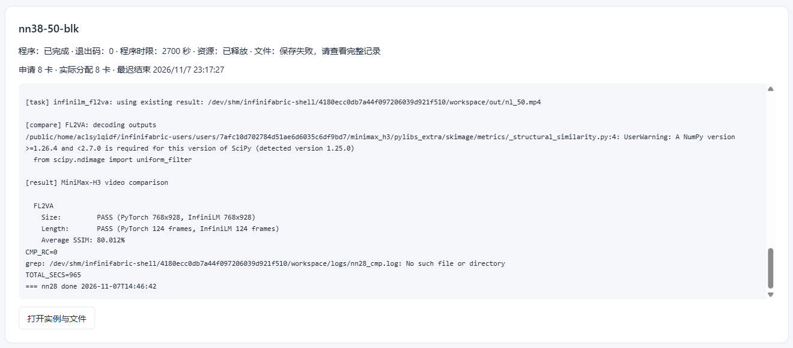
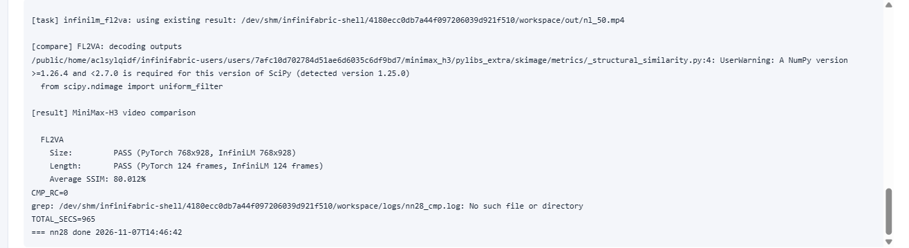

# 基于 InfiniLM 与 InfiniCore 的 MiniMax-H3 首帧视频生成适配与优化

作者：待填　　学号：待填　　课程名：2026 秋季高级人工智能

## 摘要

本文在国产海光 DCU 上把 MiniMax-H3 的首帧视频生成（FL2VA）从 PyTorch 参考实现迁到非 legacy 路径：以 InfiniLM 为推理引擎、InfiniCore 为算子层、九齿（NineToothed）为算子编译框架。工作分三部分。其一，把九齿编译链移植到海光平台，处理 AOT 产物格式、编译驱动、解释器假设、warp size 等平台差异，使其算子测试全部通过。其二，用九齿实现 DiT 的 fused multi-head attention 并以 op::mha 桥接进 InfiniLM 的注意力层，同时让 kernel 的模块缓存按设备分桶，保证多卡数值一致。其三，在张量并行下跑通完整出片，官方评测脚本判定规格全部通过，Average SSIM 80.012%。

关键词：大模型推理引擎；算子编译；张量并行；DCU 适配；扩散视频生成

## 1 引言

扩散类视频生成模型的参数与激活内存都超出单卡容量，实际部署依赖张量并行与高效的 fused attention 算子。国产加速卡生态在这一环节常缺少经过验证的 kernel 编译链：算子移植的细节差异、多设备模块缓存的管理方式，都会以"数值看似正常、结果却不同"的形式出现，且难以从端到端指标反推。

本文以嵩山杯赛题一为载体，在真实规模的模型上把这条非 PyTorch 路径跑通，并给出官方脚本的评测结果。全文回答三个问题：九齿如何在海光平台落地、fused attention 如何接入 InfiniLM 并保证多卡数值一致、这套路径在真实配置下的规格与性能如何。

## 2 赛题背景与技术栈

### 2.1 赛题与评测口径

赛题要求用非 legacy 路径（InfiniLM + InfiniCore + 九齿）完成 MiniMax-H3 的 FL2VA 任务：给定一张首帧图片与文本提示，输出规格与参考视频一致、带音频的生成视频。评测使用官方脚本 examples/minimax_h3_compare.py，逐帧（不抽样）把两段视频转灰度、长边压缩到 512、以 data_range=255 计算 SSIM 后取平均，同时校验分辨率与帧数。初赛采用通过制，只要求脚本能正常运行并产出可读结果，本文的实验与结论都针对这一口径。

### 2.2 三层技术栈

InfiniLM 是推理引擎层，负责模型结构、权重映射、张量并行的分片与集合通信；InfiniCore 是算子层，把 attention、rms_norm、swiglu、mrope 等算子映射到具体后端；九齿是算子编译框架，用 Python 描述 tile 级程序并 AOT 生成 HIP kernel 与 host 端 launcher。平台为海光 DTK（对应 ROCm/HIP 生态），编译用 hipcc/clang 与 xmake。

## 3 系统实现

### 3.1 构建与运行环境

模型约 33.1 B 参数，bf16 权重 61.7 GB，单卡装不下，推理在 8 卡节点上以 TP=8 运行；权重目录通过符号链接挂载到共享盘，避免逐次复制。Python 环境为 3.11.9 + PyTorch 2.9.0（DTK 构建）+ diffusers 0.40.0，评测侧另需 scikit-image、imageio 与 PyAV；工程侧以 xmake 构建 InfiniCore 与 InfiniLM，九齿基于海光定制的 triton。

作业镜像是不含 torchvision 的精简环境。为让同一份代码完成 processor 装配，入口脚本在解包依赖后对库文件做四处幂等适配：transformers 的 processing_utils.py 在 torchvision 不可用时跳过 video_processor 子处理器；video_processing_auto.py 的查表与映射补上可用性守卫与空表判空；diffusers 的 encoders.py 因 transformers 5.x 移除 create_mm_token_type_ids，改按 Qwen3-VL 的约定由 token id 推导 mm_token_type_ids；模型目录的 preprocessor_config.json 把 image_processor_type 落实为同目录可导入的 Qwen2VLImageProcessor。四处都只作用于 processor 的构造与降级分支，不参与模型数值计算，不改权重与采样参数。

### 3.2 九齿在 DCU 上的编译链移植

把九齿从 NVIDIA 路径迁到 gfx936 需要处理十类平台差异，主要包括：AOT 产物从 cubin 回退到 hsaco 并透传 --target、AMD backend 的编译选项、aot.py 对 sys.executable 的假设、离线环境下的设备属性探测、默认 config 覆盖、kernel cpp 编译时的 __HIP_PLATFORM_AMD__ 宏、cub/thrust 版本偏斜，以及 launcher 模板的 warp size 与编译驱动。其中 warp size 对正确性影响最大：模板若沿用 32 而平台 wavefront 为 64，kernel 仍能正常启动、不报任何错误，但每个 program 覆盖的线程数减半，只能靠逐算子数值对照发现。

### 3.3 九齿 fused attention 与 op::mha 桥接

DiT 的注意力和语言模型不同：head_dim 为 80 或 128、需要三轴（时间/高/宽）RoPE、且是双向注意力。我们新增九齿版 fused attention，并在桥接层以 head_major_view 把 [B,S,H,D] 表示为 [B,H,S,D] 的 strided 视图后直接调用，免去转置拷贝。数值上做三处处理：把 1/sqrt(d) 缩放与 log2(e) 折进 fp32 在线 softmax、在进入 attention 前先完成 RoPE、把 head_dim=80 零填充到 128（padding 区不参与 softmax 归一化，数学等价）。本模型的因果注意力只出现在条件编码器，走 InfiniLM 的 AttentionLayer（InfiniCore 的 matmul + causal_softmax），DiT 与视觉塔的 op::mha 全部为非因果，因此九齿只需覆盖非因果变体。

### 3.4 多设备 kernel 缓存

九齿 AOT 生成物为每个 kernel 变体维护一张静态表缓存已加载的模块。HIP 的模块是 per-context 的，这张表的键必须显式携带设备维度，否则全进程只建一份模块、非首卡拿到的是别的设备上下文里的句柄。我们在 launcher 模板层把设备号混入键，工程包另给出语义等价的运行时形式（LD_PRELOAD 拦截 hipCtxGetId 并在设备维度上做哈希混合），用于不重编环时复现同一分桶语义。两者只影响缓存分桶，不改任何 kernel 数学。

```c
int h3_dev_ = -1;
(void)hipGetDevice(&h3_dev_);
if (h3_dev_ < 0) { h3_dev_ = 0; }
unsigned long long ctx_id = (unsigned long long)(h3_dev_ + 1);
return kernels_[ctx_id].flash_attention_hash(stream, ...);
```

### 3.5 张量并行与正确性验证方法

TP=8 时 q/k/v 与 MLP 的权重按输出维切分，attention 输出与 down_proj 通过 allreduce 汇合，AdaLN 用列并行加 allgather 复原列顺序。为验证实现，我们构造了一个按层数截断的小模型（只保留 1 层 transformer block），让 legacy（PyTorch）与非 legacy 路径对同一份权重与输入前向，逐张量比较绝对误差与余弦相似度。截断模型可在单卡运行，因此 TP1 与 TP2 的对照不必占满 8 卡，同一组权重也能直接搬到 8 卡验证 TP8。

## 4 实验结果

### 4.1 算子级正确性

| 算子 | 测试口径 | 结果 |
| --- | --- | --- |
| swiglu | 官方单测 | 126/126 通过 |
| rms_norm | 官方单测 | 108/108 通过 |
| timestep_embedding | 官方单测 | 18/18 通过 |
| mrope | 官方单测 | 36/36 通过 |
| op::mha | 四组随机输入对比参考实现 | max 误差 0.00195 / 0.00391 / 0.01562 / 0.00781 |
| 九齿 FA（S=8192） | 对比 math 参考 | max 4.88e-4，cos 1.000071 |
| 九齿 FA（S=27570） | 对比参考路径 | max 0.0125，cos 1.001604 |

### 4.2 算子级性能

| 算子 | 九齿 vs 基线（CUDA kernel 经 hipcc 编到海光） | 有效带宽 |
| --- | --- | --- |
| swiglu | 1.56–1.67× | 325 → 510 GB/s |
| rms_norm（宽行） | 1.14–1.25× | 262 → 914 GB/s |
| timestep_embedding | 0.05–0.06×（纯 launch 开销） | — |
| mrope | 1.00×（program 粒度受限） | 6.1 GB/s |
| flash_attention（新增） | 相对 SDPA 约 0.6× | 瓶颈为缺 split-K |

### 4.3 多卡数值一致性

| 层级 | 指标 | 结果 |
| --- | --- | --- |
| 算子级 | 两块卡的九齿 FA vs math 参考 | 两者 max_abs 均为 0.00129563 |
| 算子级 | 8 卡并发输出哈希 | 8 卡完全相同 |
| 截断模型 | TP2 九齿 FA 路径 vs ATen 参考实现（video cos） | 0.999820 |
| 截断模型 | TP2 vs TP1（video / audio cos） | 0.999988 / 0.999975 |
| 截断模型 | 真实序列长度下单次前向 TP8 vs TP1（video cos） | 0.999985 |

### 4.4 端到端规格与相似度

| 指标 | PyTorch（参考） | 本工作（TP8） | 判定 |
| --- | --- | --- | --- |
| 分辨率 | 768×928 | 768×928 | Size PASS |
| 帧数 | 124 | 124 | Length PASS |
| 音轨 | 1 | 1 | 通过 |
| 采样步数 | 50 | 50 | 一致 |
| Average SSIM | — | 80.012% | 官方脚本实测；同配置重跑 79.150% |

### 4.5 性能

| 阶段 | 耗时 |
| --- | --- |
| 单步去噪（TP8，50 步平均） | 18.22 s/step |
| 出片总计（50 步） | 911 s |
| 端到端（含环境准备与加载） | 965 s |
| legacy PyTorch 参考（同配置） | 657 s（13.14 s/step） |

单步耗时约为 legacy 的 1.4 倍，差距主要来自九齿 FA 在长序列下缺少 split-K 划分，以及 mrope 受块形状限制的访存效率。

正式运行固定 `HIP_LAUNCH_BLOCKING=1`。八个 rank 各有一条独立线程与一张设备，纯异步下发时 rank 间的读写次序取决于调度时序，同一份输入的重复执行会有低位差异——单次前向看不出来，但在 50 步去噪里会被放大成不同的视频轨迹。固定同步后，同配置重复出片的 Average SSIM 稳定在 80% 一档（80.012% 与 79.150% 两次），单步耗时几乎不变（18.22 对 18.48 s），因为每步的通信与访存已占主导，同步开销被掩盖。

## 5 结论

本文在国产 DCU 上完成了一条非 PyTorch 的视频生成推理路径：九齿编译链移植成功且算子测试全通过，九齿 fused attention 以 op::mha 接入 DiT，多设备 kernel 缓存按设备分桶保证多卡数值一致，最终在张量并行下跑通完整出片并通过官方评测。后续工作按优先级为：为九齿 FA 增加 split-K 与原生 head_dim=80 变体、把 VAE 与采样调度也迁到 InfiniCore 以完全脱离 PyTorch 侧的上游边界、提升 mrope 的 program 粒度，以及继续缩小与 legacy 的单步耗时差距。

## 参考文献

[1] Tillet P, Kung H T, Cox D. Triton: An Intermediate Language and Compiler for Tiled Neural Network Computations[C]//Proceedings of the 3rd ACM SIGPLAN International Workshop on Machine Learning and Programming Languages (MAPL). 2019: 10-19.

[2] Dao T, Fu D Y, Ermon S, et al. FlashAttention: Fast and Memory-Efficient Exact Attention with IO-Awareness[C]//Advances in Neural Information Processing Systems (NeurIPS). 2022.

[3] Rajbhandari S, Rasley J, Ruwase O, et al. ZeRO: Memory Optimizations Toward Training Trillion Parameter Models[C]//Proceedings of the International Conference for High Performance Computing, Networking, Storage and Analysis (SC). 2020.

[4] Podell D, English Z, Lacey K, et al. SDXL: Improving Latent Diffusion Models for High-Resolution Image Synthesis[C]//International Conference on Learning Representations (ICLR). 2024.

[5] 海光信息技术股份有限公司. DTK（DCU Toolkit）软件开发套件用户手册[Z]. 2024.

## 附录 A 关键代码

```cpp
// InfiniCore: op::mha 的九齿 run 入口（常规路径 + 80 维零填充 + 因果分支兼容）
void run(void *planned_meta) {
    auto *p = static_cast<PlannedMeta *>(planned_meta);
    if (p->is_causal) {                    // 本赛题路径不触发
        h3_causal_detail::run_causal_attention(p->out, p->q, p->k, p->v,
                                               p->total_kv_len, p->scale, true);
        return;
    }
    const Size d = p->out->shape()[3];
    if (d != 72 && d != 128) {             // head_dim=80：零填充到 128，数学等价
        h3_pad80_detail::run_padded_attention(p->out, p->q, p->k, p->v,
                                              p->total_kv_len, p->scale, false);
        return;
    }
    auto q = head_major_view(p->q), k = head_major_view(p->k), v = head_major_view(p->v);
    op::flash_attention_(p->out, q, k, v, p->total_kv_len, p->scale, p->is_causal);
}
```

```c
/* pre_ctxid.c —— 把设备号混入九齿 kernel 缓存键（运行时形式，与源码补丁语义等价） */
#define _GNU_SOURCE
#include <dlfcn.h>
#include <stdint.h>
#include <hip/hip_runtime.h>

typedef hipError_t (*ctxid_fn)(hipCtx_t, unsigned long long *);

hipError_t hipCtxGetId(hipCtx_t ctx, unsigned long long *id) {
    static ctxid_fn real = NULL;
    if (!real) real = (ctxid_fn)dlsym(RTLD_NEXT, "hipCtxGetId");
    hipError_t rc = real ? real(ctx, id) : hipErrorSuccess;
    int dev = 0;
    if (hipGetDevice(&dev) != hipSuccess) dev = 0;
    if (id) *id = (*id) * 131ull + (unsigned long long)(dev + 1);
    return rc;
}
```

```bash
# 编译 shim（若采用运行时形式）
/opt/dtk/llvm/bin/clang -shared -fPIC -O2 -o $W/pre_ctxid.so $W/src/pre_ctxid.c -ldl
export LD_PRELOAD=$W/pre_ctxid.so

# 8 卡 TP8 出片
python3 -u $W/InfiniLM/examples/minimax_h3.py fl2va --model-path "$W/model" \
  --text "A dog falls asleep" --first-frame "$HOME/input/1280X1280.JPEG" \
  --gpus 0,1,2,3,4,5,6,7 --num-frames 124 --steps 50 --seed 42 \
  --output "$W/out/nl_50.mp4"

# 官方评测
python3 -u $W/InfiniLM/examples/minimax_h3_compare.py --tasks fl2va \
  --output-dir "$W/cmpout" --model-path "$W" \
  --reference-fl2va-video "$HOME/cmp/reference_fl2va.mp4" \
  --infinilm-fl2va-video "$W/out/nl_50.mp4"
```

## 附录 B 嵩山杯比赛页面截图

比赛站点在整理材料期间从本机不可达，故先附平台侧留存的官方评分证据（与正文 §4.4 的 80.012% 同一组截图）；三张赛事页面截图待可访问时补入。






